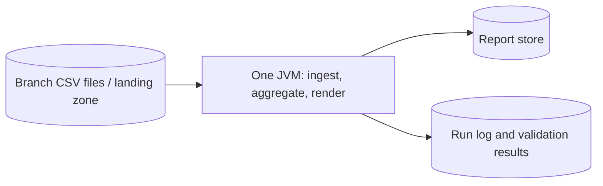
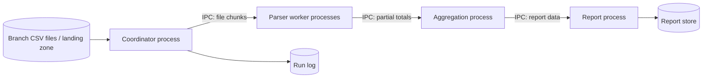
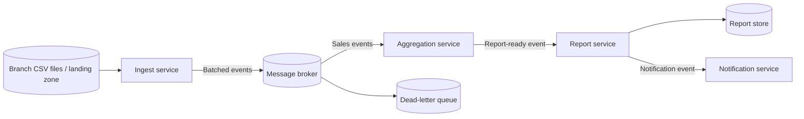

# ATAM-style evaluation: release 1 architecture

## Business drivers

* **Morning reporting deadline:** Produce the report for month M on the morning of day 2 of month M+1.
* **Branch growth:** The architecture should accommodate additional branches without requiring a complete redesign.
* **Timely reporting:** The report must be produced within the QA-1 response-time target. For the estimates below, the target is 60 seconds for 3.0 million rows.
* **Operational simplicity:** The team needs a solution that can be developed, tested, deployed and supported with its available skills.
* **Reliable reporting:** Missing or late branch files must be detected and handled without silently producing misleading totals.
* **Security:** Data movement and additional components must not introduce unnecessary exposure.

The six scenario IDs refer to `lab01/quality-scenarios.md`. The exact scenario wording and response measures must remain consistent with that file.

## Candidates

### A: Modular monolith batch

A single Java process uses separate modules for ingestion, aggregation and rendering. The modules communicate through in-process calls and shared domain objects. The batch job checks input files, calculates totals and writes the report.

### B: Process pipeline

A coordinator starts separate worker processes. Workers parse assigned chunks and send partial totals through pipes or local sockets. This adds process isolation but requires IPC protocols, worker supervision and error handling.

### C: Event-driven microservices

Independent services communicate through a message broker. The design supports buffering and independent scaling, but introduces distributed deployment, message schemas, observability and delivery-semantics concerns.

## Scenario analysis

Rating scale: **++** strongly supports the scenario; **+** supports it; **0** is broadly neutral or depends on implementation; **−** makes the scenario harder to achieve.

The scenario labels below are provisional except where the challenge brief establishes the driver. Verify them against the actual QA-1 through QA-6 definitions before submission.

| Scenario                                                                                 | A: Modular monolith                                                                                                                  | B: Process pipeline                                                                                                                   | C: Event-driven services                                                                                                                      |
| ---------------------------------------------------------------------------------------- | ------------------------------------------------------------------------------------------------------------------------------------ | ------------------------------------------------------------------------------------------------------------------------------------- | --------------------------------------------------------------------------------------------------------------------------------------------- |
| QA-1: Generate the monthly report within the response-time target                        | **++** — Parallel parsing in one JVM can process the assumed workload within 60 seconds without IPC overhead.                        | **+** — Parallel workers can meet the target, but startup, IPC and process supervision add overhead.                                  | **0** — Batching and horizontal scaling can meet the target, but one-event-per-row processing may exceed it.                                  |
| QA-2: Correct report totals (provisional; replace with actual scenario)                  | **+** — Shared domain types and one process simplify validation, although parsing and aggregation defects can still corrupt totals.  | **0** — Process isolation helps contain crashes, but partial-result protocols must preserve every transaction exactly once logically. | **0** — Durable messaging can support recovery, but duplicate delivery and event ordering require explicit idempotency controls.              |
| QA-3: Detect and handle a late or unavailable branch file                                | **+** — The batch can validate the expected branch manifest, flag missing files and rerun when late data arrives.                    | **+** — The coordinator can track each branch and restart failed workers, but needs persistent run state.                             | **++** — Durable queues and independent consumers can buffer arrivals, although the batch-completion rule still needs to be defined.          |
| QA-4: Change or extend the system (provisional; replace with actual scenario)            | **+** — Clear module boundaries allow changes without operating separate services.                                                   | **0** — Workers can be changed independently, but IPC contracts must remain compatible.                                               | **+** — Services can be changed independently, provided event schemas and compatibility are managed.                                          |
| QA-5: Protect sensitive sales data and reduce attack surface                             | **++** — One JVM and fewer network endpoints minimize exposed components, assuming appropriate file permissions and access controls. | **0** — Process boundaries add isolation, but local sockets, IPC permissions and worker privileges need protection.                   | **−** — A broker, service endpoints, credentials and network policies create more components and security configuration to manage.            |
| QA-6: Operate, recover or monitor the system (provisional; replace with actual scenario) | **+** — One scheduled job and centralized logs simplify diagnosis, although the whole process may need rerunning after failure.      | **0** — Worker restarts can limit some failures, but distributed logs and process coordination add operational work.                  | **0** — Independent services support targeted recovery, but broker operations, distributed tracing and cross-service failures add complexity. |
| Cost and skills                                                                          | **++** — Lowest infrastructure and operational burden; fits a small Java team.                                                       | **0** — Requires process management, IPC design, deployment coordination and extra tests.                                             | **−** — Highest initial and ongoing cost; requires broker operations, distributed-systems skills and stronger monitoring.                     |

## QA-1 estimates: assumptions first

### Shared assumptions

* Input size: **3.0 million rows**.
* Parsing cost: **5 microseconds per row on one core**.
* Serial aggregation merge: **2 seconds**.
* Serial rendering: **1 second**.
* Serial work total: 3 seconds.
* Parallel parsing work: 3,000,000 × 0.000005 = **15 seconds on one core**.
* Total one-core baseline: 15 + 2 + 1 = **18 seconds**.
* Available CPU capacity: 8 cores for A and the consumer/worker capacity assumed for B and C.
* QA-1 deadline used for this estimate: 60 seconds.
* These are simplified estimates, not measured benchmark results. They exclude disk delays, CSV validation overhead, contention and report-store latency unless explicitly included.

### A: Modular monolith batch

Assume 8 parser threads in one JVM, with ideal division of parsing work and no thread-management overhead.

Amdahl's law:

* Parallel fraction: 15 / 18 = **0.8333**.
* Serial fraction: 3 / 18 = **0.1667**.
* Speedup on 8 cores: 1 / (0.1667 + 0.8333 / 8) ≈ **3.69×**.

Arithmetic:

* Parallel parsing: 15 / 8 = 1.875 seconds.
* Serial aggregation and rendering: 2 + 1 = 3 seconds.
* Estimated time: 1.875 + 3 = **4.875 seconds**, or approximately **4.9 seconds**.

Result: meets the 60-second target under the assumptions.

### B: Process pipeline

Assume four worker JVMs, each receiving one quarter of the parsing workload. Worker startup costs 0.5 seconds, partial results are small, and aggregation and rendering remain serial.

Amdahl's law for four workers:

* Speedup before overhead: 1 / (0.1667 + 0.8333 / 4) ≈ **2.67×**.
* Runtime before startup and IPC overhead: 18 / 2.67 ≈ **6.75 seconds**.

Explicit IPC assumptions:

* IPC throughput: 50,000 messages per second.
* Four partial-total messages, one from each worker.
* Serialization and deserialization of all partial totals: 0.02 seconds.
* Worker startup: 0.5 seconds, assumed to overlap across workers.

Arithmetic:

* Parsing: 15 / 4 = 3.75 seconds.
* Merge and rendering: 2 + 1 = 3 seconds.
* IPC transfer: 4 / 50,000 = 0.00008 seconds.
* Estimated time: 0.5 + 3.75 + 2 + 1 + 0.02 + 0.00008 = **7.27008 seconds**, or approximately **7.3 seconds**.

Result: meets the 60-second target under the assumptions.

### C: Event-driven microservices

Assume eight consumer cores, the same 15 seconds of one-core parsing work, 3 seconds of serial merge and rendering, 0.5 seconds of service startup/readiness overhead, and 0.2 seconds of total serialization/deserialization overhead for the batched workload.

Assume broker throughput of **50,000 messages per second**. The throughput assumption counts messages, not rows.

Amdahl's law for the parallel processing portion:

* Parallel fraction: 15 / 18 = **0.8333**.
* Serial fraction: 3 / 18 = **0.1667**.
* Ideal speedup on 8 cores: approximately **3.69×**.
* Processing time before broker and serialization overhead: approximately **4.875 seconds**.

Case 1: one row per event.

* Events: 3,000,000.
* Broker time: 3,000,000 / 50,000 = **60 seconds**.
* Estimated total: 4.875 + 60 + 0.2 + 0.5 = **65.575 seconds**, approximately **65.6 seconds**.

Result: fails the 60-second target under this model, because broker time alone consumes the full budget.

Case 2: 1,000 rows per event.

* Events: 3,000,000 / 1,000 = **3,000**.
* Broker time: 3,000 / 50,000 = **0.06 seconds**.
* Estimated total: 4.875 + 0.06 + 0.2 + 0.5 = **5.635 seconds**, approximately **5.6 seconds**.

Result: meets the 60-second target under the assumptions. This depends on batching, adequate consumer capacity and a real implementation that sustains the assumed throughput.

## Sensitivity points

* **S1 — Input volume:** Increasing rows increases parsing work in A, B and C. QA-1 worsens unless CPU capacity, parsing efficiency or workload distribution also improves.
* **S2 — Serial fraction:** Increasing merge or rendering time reduces the benefit of more cores under Amdahl's law. QA-1 worsens in all candidates because parallel parsing cannot eliminate serial work.
* **S3 — Event batch size in C:** At 50,000 messages/second, 3 million single-row events require 60 seconds of broker time, while 3,000 events of 1,000 rows require 0.06 seconds. Larger batches strongly improve QA-1, but can increase memory use, latency and retry cost.
* **S4 — IPC or broker throughput:** Lower throughput increases data-transfer time in B or C. QA-1 worsens; increasing throughput helps only until parsing, aggregation or storage becomes the bottleneck.
* **S5 — Number of worker cores:** Adding cores reduces the parallel parsing term, but gains diminish as the 3-second serial fraction dominates. QA-1 improves, with diminishing returns.

## Trade-off points

* **T1 — Broker buffering versus simplicity:** C can buffer branch data that arrives late and decouple ingestion from aggregation, improving the ability to absorb arrivals and recover from temporary downstream outages. However, it adds a network hop, serialization, broker operations and a larger security surface, negatively affecting cost, operability and QA-5.
* **T2 — Process isolation versus IPC overhead:** B isolates worker failures and can restart individual processes, improving fault containment. However, process startup, IPC contracts, serialization and coordination increase implementation and test complexity compared with A.
* **T3 — More batching versus freshness:** Larger batches reduce broker overhead and improve QA-1 in C, but may delay processing until a batch fills and make a failed batch more expensive to retry. The batch-size policy must balance deadline performance and data freshness.

## Risks, non-risks and risk themes

### Risk theme 1: Morning reporting deadline and late branch data

Business driver: deliver the month-M report on the morning of day 2 of month M+1.

* **R1 — Missing or late input:** A batch job may finish quickly but still produce an incomplete report if a branch file is missing and the manifest check is weak. Mitigation: define expected branches, flag missing files, publish completeness status and rerun when late files arrive.
* **R2 — Duplicate processing after retry:** A worker restart or message redelivery may count sales twice. Mitigation: use a stable branch/business-date/file identity, content checksums and idempotent processing; a corrected file must replace the prior contribution rather than append a duplicate.
* **Non-risk N1 — More services do not automatically guarantee a faster report:** C is not inherently faster than A. With batched events and sufficient capacity it can meet QA-1, but poor batching can make broker time dominate the entire deadline.

### Risk theme 2: Cost, team capability and security exposure

Business driver: expand the chain without creating an operational burden or unnecessary exposure.

* **R3 — Operational complexity:** C requires the team to deploy, secure and monitor a broker and multiple services. Without the necessary skills, failures may be harder to diagnose. Mitigation: retain A for Release 1 and revisit the decision when scaling evidence justifies the added burden.
* **R4 — Expanded attack surface:** Additional service endpoints, broker credentials and network policies can be misconfigured. Mitigation: restrict network access, apply least-privilege credentials, encrypt data in transit and audit access.
* **Non-risk N2 — A modular monolith is not necessarily a scaling dead end:** A can use multiple parser threads and keep clear module boundaries. A later migration can be considered if measurements show that its throughput, deployment model or recovery behavior no longer meets the business drivers.

## Recommendation

**Confirm ADR-0001 for Release 1: use the modular monolith batch architecture (Candidate A).**

The scenario table and estimates support this choice for the current assumptions:

* A is estimated at approximately 4.9 seconds for 3 million rows, comfortably below the 60-second QA-1 target.
* A has the fewest infrastructure components and the lowest operational burden for the team.
* QA-3 can be addressed by manifest validation, explicit missing-file reporting, idempotent ingestion and controlled reruns without immediately introducing a broker.
* B offers worker isolation, but the modeled performance does not justify its additional IPC and process-management complexity for this workload.
* C can meet QA-1 when messages are batched, and it offers stronger decoupling for future branch growth. However, the current performance estimate does not demonstrate that A fails the business deadline, while C has the highest cost and security/operational burden.

This recommendation is conditional, not permanent. Revisit ADR-0001 and consider a superseding ADR-0003 if production measurements show that the report deadline is being missed, branch volume materially exceeds the assumptions, or late-file buffering and independent service scaling become mandatory business needs. Before selecting C, benchmark realistic batch sizes and verify the broker throughput, serialization overhead, consumer capacity and recovery behavior.
